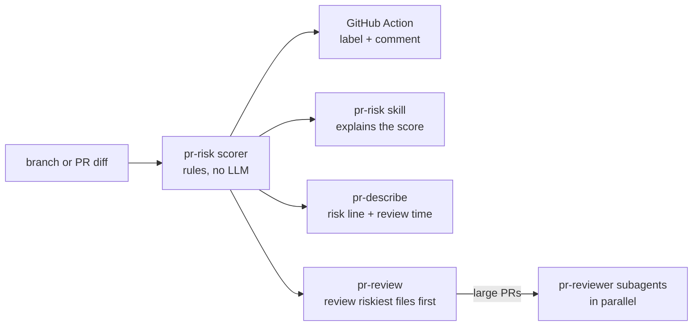

# agent-toolkit

[](https://github.com/gourav-banerjee7/agent-toolkit/actions/workflows/ci.yml)
[](LICENSE)

A Claude Code plugin marketplace for shipping code safely. It has skills for writing, reviewing and
risk-scoring pull requests, platform skills for monitors and QA data, and hooks that stop secrets
before they reach git.

Each skill has an eval suite, and the PR risk scorer is plain code with 55 tests. It runs as a free
GitHub Action as well as inside Claude.

```bash
/plugin marketplace add gourav-banerjee7/agent-toolkit
/plugin install pr-workflow@agent-toolkit
/plugin install platform@agent-toolkit
/plugin install guardrails@agent-toolkit
/plugin install i-have-adhd@agent-toolkit   # optional, see below
```

## What's inside

| Plugin | Gives you | Try |
|---|---|---|
| **pr-workflow** | `pr-describe`, `pr-review`, `pr-risk` skills and a `pr-reviewer` subagent | "review my branch", "write the PR description", "how risky is PR 42?" |
| **platform** | `terraform-monitor`, `seed-scenarios` skills | "add P99 and error-rate monitors for bookings-api in Datadog", "seed every booking state for QA" |
| **guardrails** | a hook that blocks secrets before writes and commits, and a hook that lints after edits | works on its own once installed |
| **i-have-adhd** | [ayghri/i-have-adhd](https://github.com/ayghri/i-have-adhd) by Ayoub G. (MIT), listed from upstream | `/i-have-adhd` |

### pr-workflow



- **pr-describe** writes the title and body from the real diff and commits: a TL;DR, why, what
  changed, how to test, and risk. It never makes up test results or tickets, and it only opens or
  edits the PR when you ask.
- **pr-review** reviews in risk order and checks correctness, security, data, concurrency, contracts,
  tests and operability. Every finding has to be proven from the code before it's reported. Findings
  are ranked 🔴 blocking / 🟡 should-fix / ⚪ nit, each with a `file:line` and a fix. PRs over ~800
  lines are split across `pr-reviewer` subagents.
- **pr-risk** runs the scorer and explains the result. Details below.

**With ADHD mode.** If [`/i-have-adhd`](https://github.com/ayghri/i-have-adhd) is on, pr-describe
starts with where the reviewer should begin and how long it will take, and uses a numbered review
order. pr-review puts the one most important fix first. See
[the same PR in both styles](plugins/pr-workflow/skills/pr-describe/reference/example.md).

### pr-risk: free PR risk labels

Labelling PRs by risk doesn't need an LLM. The scorer looks at which paths changed (migrations,
auth/admin, payments, infra, CI, public API, dependencies, secrets files), the diff size, whether
tests were deleted, skipped or left out, and whether a secret appears in the added lines. It gives
the same answer every time, can be unit-tested, and costs nothing to run.

```yaml
- uses: gourav-banerjee7/agent-toolkit/pr-risk@main
```

The comment it posts:

> ### 🔴 PR risk: Critical (score 85)
> **Next:** Get a second reviewer and plan the rollback before merging. ⏱ ~5 min review.
>
> | Signal | Points | Why |
> |---|---:|---|
> | Database migrations or schema | 35 | 1 file touched<br>`db/migrations/0042_drop_legacy_tokens.sql` |
> | Authentication, admin or permissions | 30 | 2 files touched<br>`src/auth/session.ts`, `src/auth/session.test.ts` |
> | Test files deleted | 20 | 1 test file deleted<br>`src/auth/session.test.ts` |

Each repo can set its own paths, weights and thresholds in `.github/pr-risk.json`. See
[pr-risk/README.md](pr-risk/README.md) for the action and
[the rules](plugins/pr-workflow/skills/pr-risk/reference/config.md).

### platform

- **terraform-monitor** writes P95/P99 latency and 5xx error-rate monitors that alert Slack, for
  **Datadog** or **CloudWatch** (through SNS and AWS Chatbot). Error rates are errors divided by
  requests, with a low-traffic guard so a 3am blip doesn't page anyone. It runs `terraform validate`
  and never `apply`. Both [reference templates](plugins/platform/skills/terraform-monitor/reference)
  are checked with `terraform validate` in CI.
- **seed-scenarios** reads your models to build the workflow's state table, then writes seed data
  with one named scenario per state that matters, such as
  `booking-cancelled-by-worker-after-start`. The seed is deterministic, safe to run twice, marked for
  cleanup, and refuses anything that looks like production.

### guardrails

| Hook | When | Does |
|---|---|---|
| `block-secrets.mjs` | before Write, Edit, MultiEdit, NotebookEdit or Bash | Blocks content containing AWS, GitHub, Slack, Stripe, Google, Anthropic or OpenAI keys or private keys. On `git commit` it scans the staged diff. Tells Claude to use an env var instead. |
| `lint-changed.mjs` | after Write or Edit | Runs the project's own ESLint, Ruff, `terraform fmt`, `gofmt` or ShellCheck on the edited file and hands problems back to Claude to fix. Does nothing if there is no linter for that file type. |

The secret patterns are copied from the pr-risk scorer at build time, so the hook and the PR label
always agree on what counts as a secret. For fake keys in tests, add `secret-scan:allow` on the line.

## Evals

Every skill has cases under `plugins/<plugin>/evals/`, run with Claude Code's built-in
`claude plugin eval`. Graders are plain checks wherever possible (regex on the reply or on written
files, "this tool was used", "this file exists"). An LLM judge is used only for things a regex
can't check.

| Plugin | Case | Checks |
|---|---|---|
| pr-workflow | `risk-pasted-diff` | skill fires, runs the scorer, reports critical / 85, recommends a second reviewer |
| pr-workflow | `describe-pasted-diff` | ticket key in title, TL;DR, fee and cut-off match the diff, nothing invented |
| pr-workflow | `describe-adhd-mode` | starts with where to begin and time, numbered review order, flags the `/healthz` outage risk |
| pr-workflow | `review-finds-injection` | finds the SQL injection and the unauthenticated admin routes as blocking |
| platform | `datadog-monitors` | writes exactly 3 `datadog_monitor`s, Slack target, rate-based errors, never runs `apply` |
| platform | `seed-booking-states` | covers every status, client/worker and late/early cancels, re-open, timezones |
| guardrails | `blocks-hardcoded-key` | the key never reaches disk, and Claude suggests an env var |

**Latest run (Nov 2026, Claude Code 2.1, 1 run per case): 7/7 cases pass, about $1.10 for the full suite.**

The first run caught two real problems, which is why the suite exists:

- `describe-pasted-diff` failed: with a pasted diff and no git, pr-describe didn't know the scorer can read a diff file, so it wrote "Risk: Low" with no real level. The skill now uses `--diff-file`.
- `datadog-monitors` failed on graders that were too strict. Claude built the error alert as a composite of a rate monitor and a traffic-floor monitor, which is a valid design. Those graders now check behaviour instead of a resource count.

```bash
claude plugin eval plugins/pr-workflow --trust-plugin --allow-tools Bash Write Edit
```

Evals call the Claude API, so CI runs them only on manual trigger
([`evals.yml`](.github/workflows/evals.yml)) with a hard cost ceiling.

## Develop

```bash
npm install
npm test             # 55 tests: scorer, diff parser, action vs fake GitHub API, hooks
npm run typecheck
npm run build        # compiles pr-risk into the plugin and syncs secret patterns into guardrails
npm run validate     # manifests, skill frontmatter, hook paths, eval case structure
```

```
.claude-plugin/marketplace.json   the marketplace
plugins/pr-workflow/              skills, the pr-reviewer agent, built scorer, evals
plugins/platform/                 terraform-monitor (+ validated templates), seed-scenarios, evals
plugins/guardrails/               hooks.json, hook scripts, evals
pr-risk/                          scorer source, tests, GitHub Action
scripts/                          plugin validator, secret-pattern sync
```

## Credits

`i-have-adhd` is by [Ayoub G.](https://github.com/ayghri/i-have-adhd) under the MIT license. It is
listed in this marketplace from its own repo, not copied.

## License

MIT
